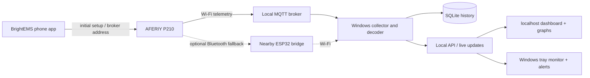
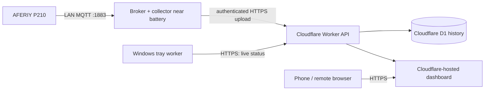

# AFERIY P210 desktop monitor — project plan

Status: **Cloudflare foundation deployed** (10 November 2026). The phone's Local MQTT settings screen has been confirmed. A private cloud dashboard, D1 history database, and protected ingest API are live. The battery receiver, actual telemetry, and Windows tray worker are still to be built.

## Goal

Show every reading that this particular P210 actually exposes to BrightEMS on a Windows computer, retain a time-stamped history, and provide a small local website and Windows tray monitor. When the P210 is supplying power to the PC, show a clear discharging state and remaining-time estimate. Below 15% charge, give a prominent reminder to save work and shut down the PC. Never shut down the PC automatically.

## Key finding and first decision

AFERIY says the app-enabled model is labelled **AF-P210-APP**, while the standard **AF-P210** does not support its app. The fact that the user's unit works with the app strongly suggests an app-enabled variant, but the label and firmware must be checked. AFERIY identifies **BrightEMS** as its app. The user's “bring pms” is provisionally interpreted as BrightEMS; confirm the exact app name on the phone. [AFERIY app guide](https://www.aferiy.com/pages/app-guide)

An existing [P210-compatible integration](https://github.com/iamslan/ha-fossibot) documents **BrightEMS 1.6.0+ → Me → Settings → Local MQTT Broker Settings**. It says the P210 can send telemetry directly over Wi-Fi to an MQTT broker on the local network, without the phone staying in Bluetooth range. This is the preferred route to test. It needs the account that originally bound the device, the device on Wi-Fi, and a broker address reachable from the P210 on TCP 1883. Its device discovery and online/offline sync still need internet at startup; the telemetry path itself is local. The setting is now confirmed on this phone, but usable messages from this particular P210 still need verification. [Integration setup and requirements](https://github.com/iamslan/ha-fossibot#requirements)

### Confirmed from the user's settings screenshot

- The page is titled **Local MQTT Broker Settings**; the feature is currently **off**.
- **MQTT Broker Host** and optional **Username** are blank. The screen specifies device connection port **1883**.
- **Controlled Devices: 1** appears. This does not by itself identify that device or prove it has Wi-Fi connectivity; inspect the Controlled Devices page before setup.
- An API token is displayed. Treat it as a secret; its value is deliberately not copied into this plan. Because it appeared in a shared screenshot, regenerate it before using the integration, then put the replacement only in protected local configuration. Do not send another screenshot containing the token.
- The screen says all devices bound to the account can be affected and that devices must be restarted after submitting broker settings. Plan the test accordingly. These are observed on-screen instructions, not evidence that any settings have yet been submitted.

### Next connection test

1. Prepare an MQTT broker on the Windows PC and identify the PC's **LAN IPv4 address**. The host field needs that reachable LAN address or hostname, **not** `localhost` or `127.0.0.1`, because the battery is a separate device.
2. Check that the P210 is the one listed in **Controlled Devices**, that it is on the same reachable network, and that the PC firewall permits the battery to reach TCP 1883 on the private network.
3. Regenerate the exposed API token and store the replacement privately. Configure the broker's authentication to match the app's username setting if needed; start with a LAN-restricted test configuration.
4. Enable Local MQTT, enter the broker host, submit, and restart the affected power station as the app requests. Check that this can be done without interrupting important work powered by it.
5. Capture read-only telemetry and compare live charge/input/output readings against the app. Then take the phone out of Bluetooth range to confirm that updates continue. If not, diagnose network and broker reachability before proceeding.

If that setting is absent or does not work, investigate a local Bluetooth receiver near the battery. The [ESP-FBot project](https://github.com/Ylianst/ESP-FBot) supports P210 telemetry through an ESP32 within Bluetooth range and relays it over Wi-Fi. This requires extra hardware and would need an adapter into our local collector. A Windows Bluetooth connection is another possible experiment if the PC is within range, but it does not meet the stated remote-range use case by itself.

## Proposed layout

Initial deployment: broker, collector, SQLite, website, and tray worker on the Windows PC. The browser and tray worker read the same normalized data, so status, timestamps, and alerts agree. The website binds to `127.0.0.1`; only the broker needs LAN access. If history must continue while the PC is off, move the broker and collector/database to an always-on machine later; the Windows tray worker can then connect over the LAN. A PC that has lost power cannot show alerts or keep logging.

## Cloudflare-hosted website option

**Implemented as a hybrid foundation.** The website, API, and D1 history are deployed at [aferiy-p210-monitor.pages.dev](https://aferiy-p210-monitor.pages.dev). See [cloud/README.md](cloud/README.md) for the source and access instructions. The P210 still needs an MQTT receiver that it can reach on TCP port 1883. A public Cloudflare Pages/Workers URL cannot directly accept the P210's raw MQTT connection. Cloudflare [documents direct inbound TCP as unavailable from the public Internet](https://developers.cloudflare.com/workers/runtime-apis/handlers/connect/); its TCP API is primarily for outbound connections. [Spectrum can proxy MQTT](https://developers.cloudflare.com/spectrum/), but custom TCP applications require an Enterprise add-on and still need a broker origin, so that is not a practical first choice.

The broker and collector can initially run on the Windows PC. If the PC shuts down during an outage, uploads and logging stop until it restarts. For genuinely continuous history, run them on an always-on home device (for example, a small low-power computer) powered through the outage. The Windows tray worker remains necessary because a website/Worker cannot maintain a Windows notification-area icon when the browser is closed.

Cloudflare implementation: use a Worker with static assets for a new project (Cloudflare [currently recommends Workers Static Assets over new Pages projects](https://developers.cloudflare.com/workers/best-practices/workers-best-practices/)); an existing Pages project can also serve the site and bind [Pages Functions to D1](https://developers.cloudflare.com/pages/functions/bindings/). The collector sends batched readings to a protected HTTPS ingest endpoint. D1 stores recent and downsampled history; the API supplies current status and graph ranges. Require login for the private dashboard and a separate ingest secret for the collector. Never put the BrightEMS API token in public site code. Design for reconnects, duplicate uploads, stale data, and a bounded retention policy. Check [D1 pricing and limits](https://developers.cloudflare.com/d1/platform/pricing/) against the chosen sample frequency before deploying.

An entirely cloud-hosted collector would require a separate internet-accessible MQTT broker or a vendor API we can prove works for this device. Neither has been validated here, and pointing the P210's port-1883 connection at an arbitrary public broker would need a separate security and reliability assessment. The local-receiver-plus-HTTPS-upload design is the recommended path.

## Data inventory to verify on the real unit

Do an observed field-by-field inventory of the BrightEMS screens and received telemetry. Record name, unit, range, update frequency, raw register/topic, and whether the field is live, static, or a setting. The [P210-compatible integration's entity catalogue](https://github.com/iamslan/ha-fossibot#entities) is a starting point, **not** proof that every field is populated on this unit. It lists:

- Battery: state of charge, usable capacity, charging/discharging flags, and available battery diagnostics.
- Input: mains, solar/DC, USB-C, total input power and input-present states.
- Output: total, AC/inverter, USB, DC, individual port power and on/off states where reported.
- AC electrical values: input/output voltage and frequency.
- Time and energy: the battery's remaining charge/discharge minutes and cumulative solar energy where reported.
- Device state: grid present, on-grid/off-grid, ECO mode, faults, connectivity, and available BMS status.
- Settings shown in the app: charge/discharge limits, charging mode/rate, standby timers, output controls and similar values. Initially display them as **read-only**. The project is for monitoring; device control would require separate validation.

For each field, distinguish **not supported**, **not present on this unit**, **temporarily unavailable**, and **zero**. Save the raw payload as well as decoded values so a later decoder correction does not erase evidence.

## Behaviour specification

### Collector and history

1. Connect and reconnect to the broker; identify the correct device and reject unrelated topics/devices.
2. Decode telemetry using the documented P210/SYDPOWER register map, with version checks and unit tests against captured samples. Reuse or adapt the existing open-source decoder only after checking its licence and current code.
3. Record a timestamp in UTC for each received sample, plus source, device ID, quality, and raw payload. Use the device timestamp only if it is actually supplied and trustworthy.
4. Store normalized numeric/boolean measurements in SQLite and keep raw messages for diagnostics. Suggested tables: `devices`, `samples` (received time, device, raw payload, decoder version), `measurements` (sample, key, value, unit), `events` (power transitions, faults, alerts), and `settings` (local preferences). Add indexes on device/time and measurement key/time.
5. Use WAL mode, transactions, bounded retention/downsampling for long-term history, and a simple backup/export path. Retain enough raw samples to debug decoder changes without unbounded database growth.
6. Show the most recent successful update time. Mark data **stale** after a configurable gap (initial suggestion: 2 minutes) and **offline** after a longer gap. Never present an old charge level or ETA as live.

### Local website and widget

1. Serve on `http://127.0.0.1:<port>` with a compact live overview: charge %, charging/discharging/idle/offline, input and output W, remaining time, fault state, and last update.
2. Offer a full readings page grouped by category, including raw/advanced fields when useful. Label unsupported fields rather than inventing values.
3. Add history charts for charge %, input/output W, and ETA, with selectable ranges (e.g. 1 hour, 24 hours, 7 days, 30 days), gaps for missing data, and charging/outage events.
4. Provide a small resizable desktop widget or compact website mode after the core dashboard works; use the same API and status rules.
5. Provide CSV/JSON export, local settings for thresholds/retention, and a clear connection-health page.

### Windows tray worker and warnings

1. Start on Windows sign-in if enabled. Run as a single background instance with a tray icon and menu: current status, charge %, ETA, open dashboard, pause alerts, exit.
2. Determine “running on battery” from the P210's **mains-input-present / on-grid state plus battery-discharging and power-flow data**. Do not infer it only from Windows' own battery status. Verify the rule with a real unplug/replug test, including solar input and simultaneous input/output cases.
3. Icon colours/states: charging, grid present/idle, discharging, low (<15%), stale/offline, and fault. Keep a text tooltip so colour is not the only signal.
4. During discharge, show the P210's reported remaining-discharge time if plausible. Cross-check with a smoothed estimate from charge and recent net power; show “estimate unavailable” when values are missing or load changes too much. Never promise an exact shutdown time.
5. Show one notification on a confirmed transition to battery, a lower-priority low-time notification at a configurable threshold, and a prominent **below 15%** notification: “Save your work and shut down this PC soon.” Optionally repeat at 10% and 5%, with rate limiting and reset only after charge recovers above a hysteresis threshold.
6. If data goes stale during a discharge, show “Battery status unavailable” rather than suppressing concern or repeating old ETA. Do not auto-save applications or shut down Windows in the first release.

## Build order and acceptance checks

| Stage | Work | Evidence needed before moving on |
| --- | --- | --- |
| 0. Confirm device | Check rear label/SKU, BrightEMS exact name/version, Wi-Fi connection, master account, and Local MQTT Broker Settings. Record screenshots or a field list without sharing credentials. | A clear route to actual telemetry. |
| 1. Connection proof | Run a LAN-only test broker; point BrightEMS to it; capture a short read-only sample while charging, idle, and discharging. Confirm phone can be out of Bluetooth range. | Repeated messages from this P210 with stable identifiers; app still works. |
| 2. Decode and map | Match received fields to app readings and the P210 register map. Identify unavailable fields and any firmware differences. | Charge %, input/output W, mains state, time estimate, and faults agree with device/app within sensible tolerance. |
| 3. Persistence | Implement collector, SQLite schema, migration, reconnect handling, and retention. | Several hours of samples with correct timestamps, no duplicate storm, and visible gaps after interruption. |
| 4. Website | Implement local API, live dashboard, full readings, and history charts. | Live values and charts match stored samples; stale/offline is visible. |
| 5. Tray worker | Implement single-instance autostart, status icon, tooltip, ETA, and notifications. | Unplug/replug and 15% threshold simulations behave correctly; no notification spam. |
| 6. Packaging | Provide a simple Windows installer/start command, configuration screen, backup/export, and operating instructions. | A reboot restores monitoring without manual console work. |

## Decisions and information needed before implementation

- Confirm the exact phone app name and version; a screenshot of its **Me → Settings** screen would settle whether local MQTT is available.
- Check the P210's rear SKU and whether it is already connected to 2.4 GHz Wi-Fi. The phone's remote access suggests a network path, but does not prove which route it uses.
- Decide whether this Windows PC is normally on whenever history and alerts are needed. If not, an always-on broker/collector host is required for continuous logging.
- List any app screens/measurements the user particularly wants; the first live capture will determine what the unit actually reports.
- Confirm whether the user wants monitoring only. This plan keeps all battery settings and output switches read-only.

## Important implementation limits

The local MQTT broker should accept only the battery's LAN traffic and the local collector; it should not be exposed to the public internet. Store API tokens in a user-specific credential store or protected local configuration, never in the repository or logs. The [integration warns](https://github.com/iamslan/ha-fossibot#writing-to-your-device) that unsafe register writes can permanently damage device operation, so the collector must subscribe/read only. If the P210 sleeps, the integration notes that readings may temporarily be unavailable until it wakes. The displayed ETA and 15% reminder depend on fresh readings and cannot guarantee that the PC has enough time for a graceful shutdown.

## Sources checked

- [AFERIY app guide and SKU distinction](https://www.aferiy.com/pages/app-guide)
- [AFERIY P210 product page and BrightEMS setup](https://www.aferiy.com/products/aferiy-p210-portable-power-station-2400w-2048wh-silver)
- [P210-compatible local MQTT integration](https://github.com/iamslan/ha-fossibot)
- [Integration protocol audit](https://github.com/iamslan/ha-fossibot/blob/main/docs/PROTOCOL_AUDIT.md)
- [ESP-FBot Bluetooth fallback](https://github.com/Ylianst/ESP-FBot)
