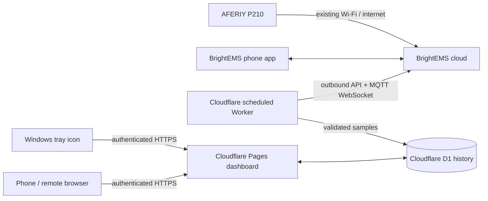

# P210 monitoring project

## Current state

The password-protected website and D1 database are live. A Cloudflare Worker logged into a separate BrightEMS account, found the P210, and saved a real reading on 10 November 2026. At that time the site showed 29.1% charge, 1 W input, and 179 W output. These fields still need comparison with the phone app. The Windows tray icon is installed and reads the hosted website.

## Architecture

Cloudflare connects **outward** to the vendor cloud every minute. The P210 keeps using its normal internet connection; the phone and Windows PC do not need to stay on. The tray icon runs only while Windows is on. The Local MQTT setting in BrightEMS should remain off for this route. Cloudflare Pages cannot accept the P210's raw inbound MQTT connection directly ([Cloudflare protocol support](https://developers.cloudflare.com/workers/reference/protocols/)); the cloud route uses the vendor's existing remote connection.

The cloud protocol is based on the community [fossibot-ha integration](https://github.com/ldiogoz/fossibot-ha), which connects to BrightEMS cloud and reads Modbus registers over vendor MQTT. That integration is not proof that this P210's cloud account/device supports the same read path. The Worker only requests readings; it never sends register-write commands. A [different community bridge warns](https://github.com/tkaufmann/fossibot-mqtt-bridge#status-and-limitations) that another login on the same account may sign the phone app out. A dedicated BrightEMS email/password account with the P210 shared to it is preferable if the app supports sharing.

## Steps to finish

1. Confirm that Cloudflare's scheduled collection adds a sample each minute without the Windows PC doing any collection. The account secrets are installed in Cloudflare, outside the repository.
2. Compare the first readings against BrightEMS: charge %, total and source input W, total and source output W, AC/grid state, and remaining-time field. Correct the register map for this firmware before treating values as reliable.
3. Display every verified reported field and mark absent fields as unavailable. The current Worker captures the mapped raw register values but has not verified the full app field inventory. Its runtime figure is a rough calculation using the P210's rated 2048 Wh capacity and current load; compare it with actual discharge behaviour before relying on it.
4. Check history graphs, stale-data handling, and the 15% tray notification during a safe discharge test. The tray never shuts down Windows automatically.
5. Set a suitable history retention/export policy after observing sample volume. Check Cloudflare D1 usage and Worker failures in the dashboard.

## Existing pieces

| Part | Location | State |
| --- | --- | --- |
| Hosted dashboard and history | `cloud/` | Deployed, waiting for readings |
| Cloud collector | `worker/` | Deployed; first real sample saved; readings need app comparison |
| Windows tray icon and alerts | `collector/tray.py` | Implemented; reads hosted status, needs live transition test |
| LAN broker/collector prototype | `collector/` | Superseded; not required for PC-off logging |
| GitHub deployment | `.github/workflows/deploy-pages.yml` | Pages deployment verified; Worker deployment step added |

## Safety and limits

The 15% warning is based on fresh battery telemetry, not Windows' own battery reading. If the vendor cloud is unavailable or the P210 sleeps, the site and tray must label readings stale. The precise "PC is on battery" rule and ETA need real unplug/replug observations; current power-flow inference is provisional. The Cloudflare collector uses an unofficial vendor protocol that may change without notice. Do not rely on it as the sole protection against lost work.
