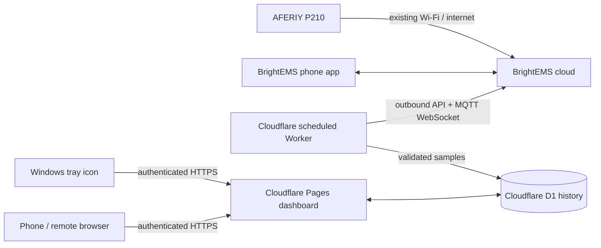

# P210 monitoring project

## Current state

The public read-only website and D1 database are live. A Cloudflare Worker logs into a separate BrightEMS account, finds the P210, and saves a reading every minute. On 10 November 2026, the cloud reported 28.7% charge, 451 W input, and 151 W output; the owner confirmed the input and output matched BrightEMS at that time. The Windows tray icon is installed and reads the hosted website. It has simulated alert tests, but a real low-battery discharge test remains.

## Architecture

Cloudflare connects **outward** to the vendor cloud every minute. The P210 keeps using its normal internet connection; the phone and Windows PC do not need to stay on. The tray icon runs only while Windows is on. The Local MQTT setting in BrightEMS should remain off for this route. Cloudflare Pages cannot accept the P210's raw inbound MQTT connection directly ([Cloudflare protocol support](https://developers.cloudflare.com/workers/reference/protocols/)); the cloud route uses the vendor's existing remote connection.

The cloud protocol is based on the community [fossibot-ha integration](https://github.com/ldiogoz/fossibot-ha), which connects to BrightEMS cloud and reads Modbus registers over vendor MQTT. That integration is not proof that this P210's cloud account/device supports the same read path. The Worker only requests readings; it never sends register-write commands. A [different community bridge warns](https://github.com/tkaufmann/fossibot-mqtt-bridge#status-and-limitations) that another login on the same account may sign the phone app out. A dedicated BrightEMS email/password account with the P210 shared to it is preferable if the app supports sharing.

## Steps to finish

1. Leave the PC off for a short safe period, then confirm the Cloudflare history continued updating. The account secrets are installed in Cloudflare, outside the repository; the local receiver is disabled.
2. Compare all available BrightEMS fields against the saved raw registers, especially AC/grid presence, faults, individual ports, and the device's own remaining-time field. The current site shows charge, total/source input, total output, power-flow state, and a rough ETA.
3. Display every verified reported field and mark absent fields as unavailable. The Worker saves all 80 input registers and tries a separate read-only request for 86 settings/holding registers. Its runtime figure uses the P210's rated 2048 Wh capacity and current load; compare it with actual discharge behaviour before relying on it.
4. Check the charge and power history graphs, stale-data handling, and the 15% tray notification during a safe discharge test. The tray never shuts down Windows automatically.
5. Set a suitable history retention/export policy after observing sample volume. Check Cloudflare D1 usage and Worker failures in the dashboard.

## Existing pieces

| Part | Location | State |
| --- | --- | --- |
| Hosted dashboard and history | `cloud/` | Public read-only; charge and power graphs built |
| Cloud collector | `worker/` | Deployed; minute-by-minute readings received |
| Windows tray icon and alerts | `collector/tray.py` | Installed; reads hosted status; real outage test remains |
| LAN broker/collector prototype | `collector/` | Superseded; not required for PC-off logging |
| GitHub deployment | `.github/workflows/deploy-pages.yml` | Pages deployment verified; Worker deployment step added |

## Safety and limits

The 15% warning is based on fresh battery telemetry, not Windows' own battery reading. If the vendor cloud is unavailable or the P210 sleeps, the site and tray must label readings stale. The precise "PC is on battery" rule and ETA need real unplug/replug observations; current power-flow inference is provisional. The Cloudflare collector uses an unofficial vendor protocol that may change without notice. Do not rely on it as the sole protection against lost work.
